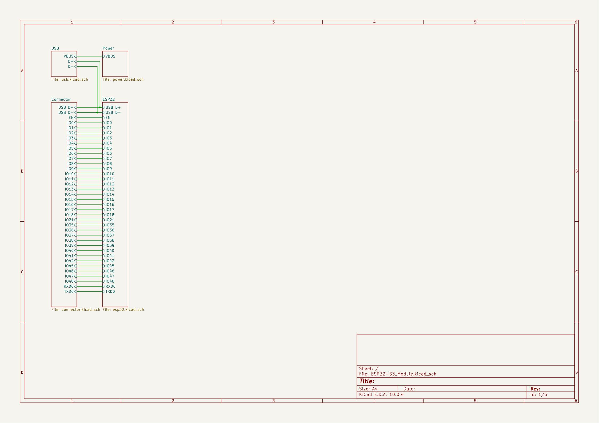
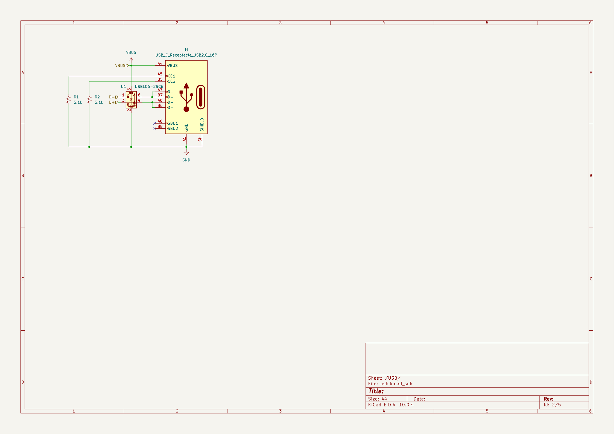
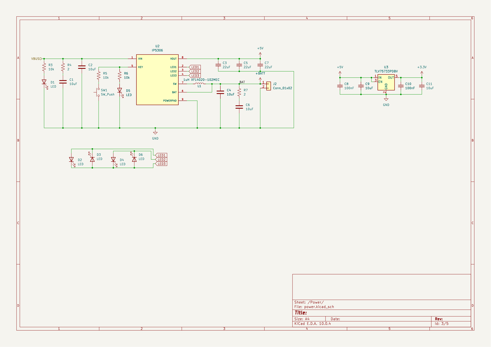
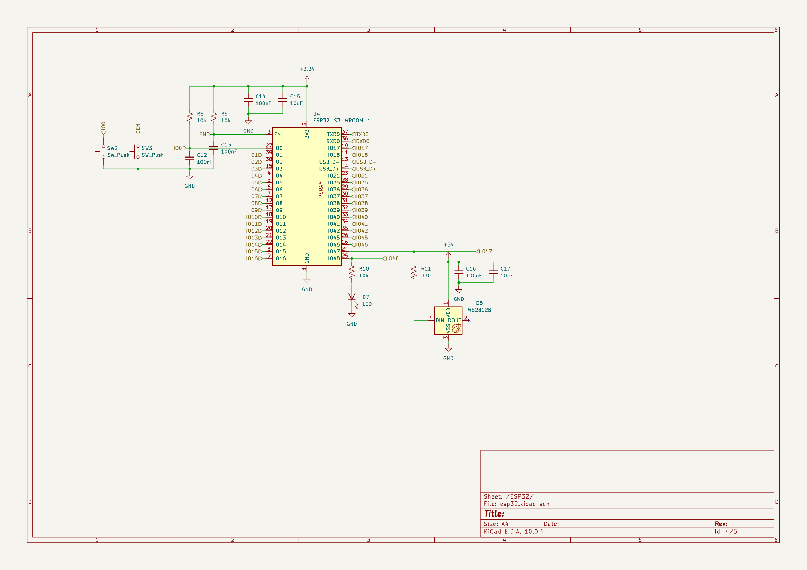
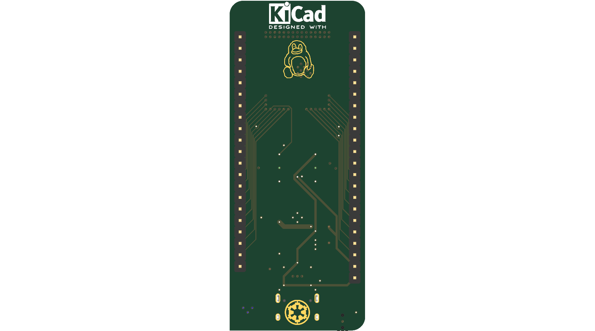

# September 2

Started the ESP32-S3 Project.
I wanted a quick and easy way to prototype my projects and all of my other esp32's were either:
1. Not esp32 (esp8266)
2. No USB (needed FTDI)
3. Not esp32-s3

Placed first components like USB-C and the main ESP32 MCU

**Total Time Spent: 2 hours**

# September 3

More work done on schematic, like the 3.3v regulator and capacitors/resistors

**Total Time Spent: 2 hour**

# September 12

Full design laid out on main sheet:
- ESP32-S3-WROOM-1 MCU
- USB-C with ESD protection and CC resistors
- IP5306 Power management IC
- TLV73733PDRV 3.3v LDO
- Header pins
- Buttons for Reset and Boot0

Started PCB to test fit parts, then went back to do more schematic work.
Did a final pass on the root sheet, net labels andd cleaning

**Total Time Spent: 3 hours**

# September 13

Split the design into subsheets:
- Root
- USB
- Power
- ESP32
- Connector

Copied IP5306 section from existing IP5306 projects

fixed footprints

## Started PCB layout

Rough positioning on the board
Schematic fixes to match footprints on the board
Worked on esp32 pull up resistors
connector sheet edits for more power connections
test ip5306 layout

beefed up traces for power connections
rounded pcb edges
ground zone fill
generated production output

## Packaging

generated step model
git repo initialized
took screenshots of everything
made readme
made journal

Still need to work on BOM

**Total Time Spent: 4 hours**

# October 5: Parts Arrived

## What I did:

- Parts arrived!  (PCBs and components)
- Checked every part off against the BOM before touching anything

## Why:

- Wanted to catch a missing or wrong part before starting, so a bad line would not stall assembly halfway through

## Screenshots:

**Total time spent: 1 hour**

# October 6-7: Assembly and First Power-Up

## What I did:

- Assembled the board: SMD parts first, then the through-hole connectors by hand
- First power-up over USB-C and the ESP32-S3 booted
- Tested charging - battery charges and board runs when usb-c connected
- Tested discharging - the board runs fine with battery connected, no usb

## Why:

- Wanted to prove the power path first
- all power runs off 5V line

## Screenshots:

**Total time spent: 4 hours**

# October 8: Testing at School

## What I did:

- Took the board to school and ran it off the battery with the Key LED in torch mode

## Why:

- Wanted to check it worked away from the bench, on battery only with no USB attached
- School finished before battery drained even 10% (started at 100%, finished around 85%)

## Screenshots:

**Total time spent: 1 hour**

# October 10: NeoPixel Demo

## What I did:

- Crimped a connector for the battery
- Got the NeoPixel rainbow running and recorded the demo video

## Why:

- using a connector instead of soldered battery so i can use the battery for other projects

## Screenshots:

**Total time spent: 2 hours**

# October 11: Battery Connector and Power Bank

## What I did:

- Soldered the JST-PH connector onto the board
- Re-tested the NeoPixel
- Ran the board from a power bank to check the boost

## Why:

- The onboard JST-PH is the permanent battery connector, so I wanted it soldered down and re-verified before trusting it
- I can now disconnect the battery from the board

## Screenshots:

**Total time spent: 2 hours**
