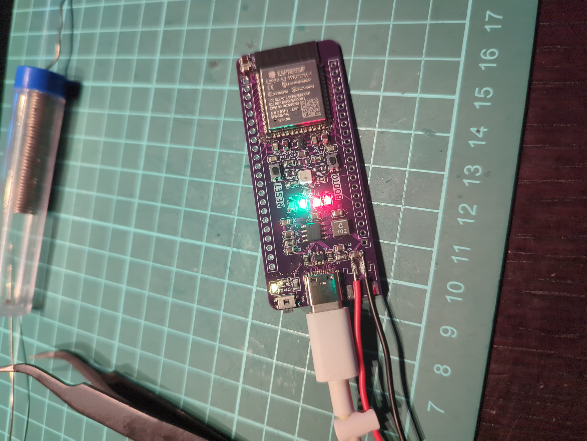
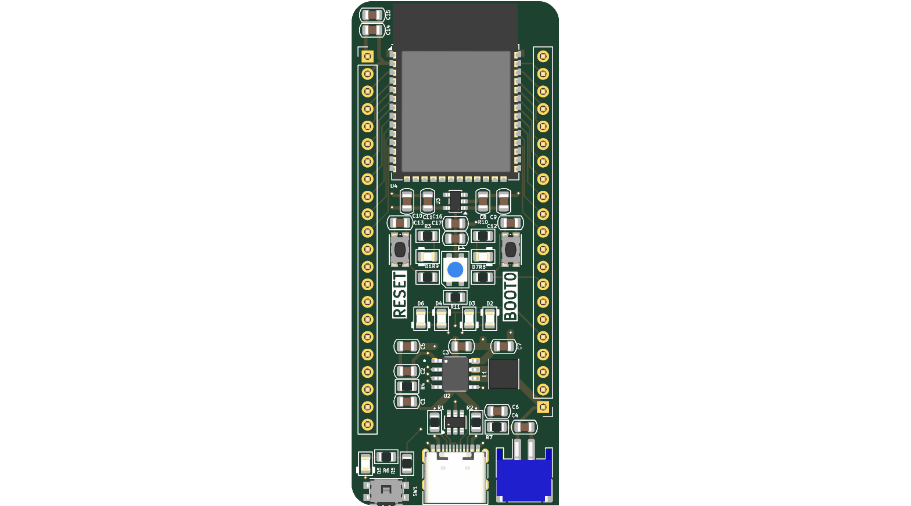
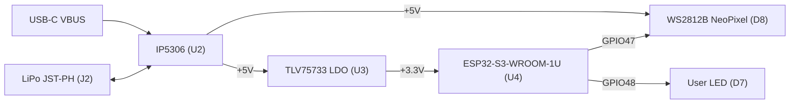
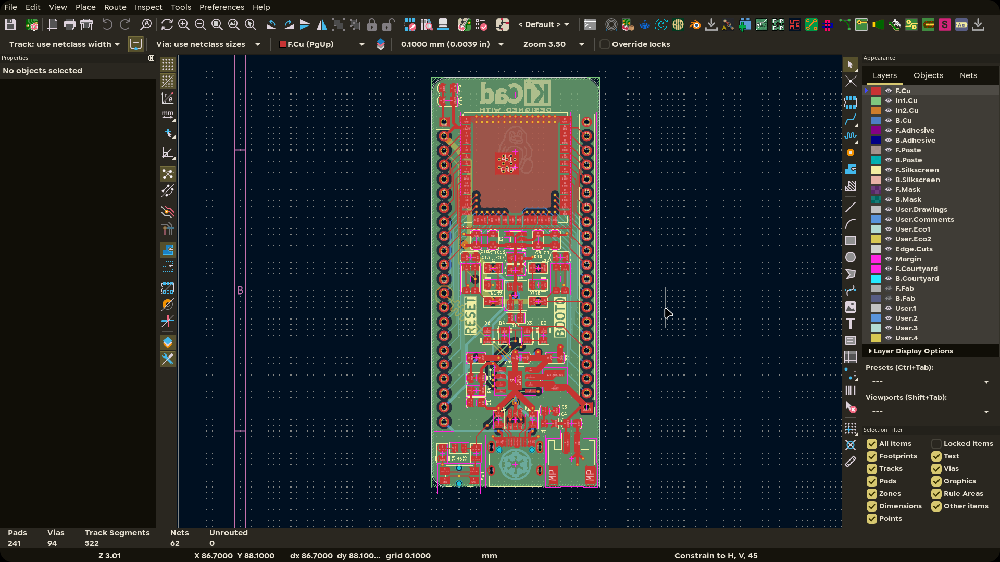
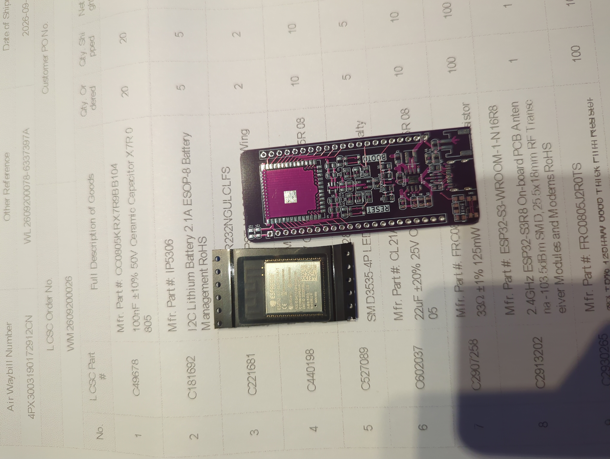
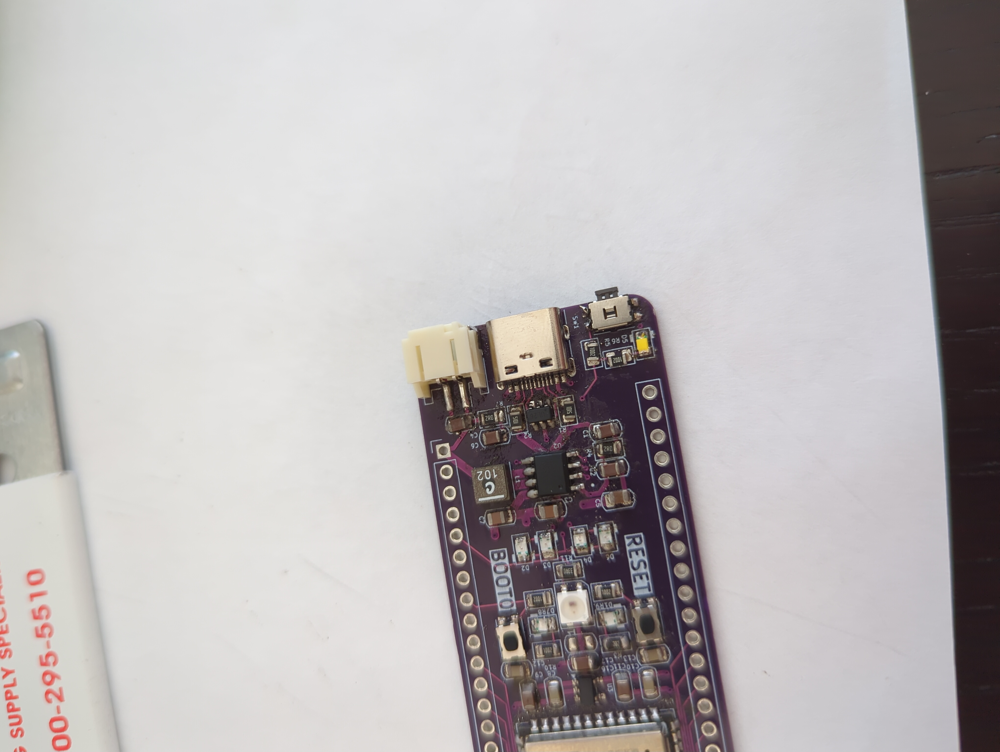
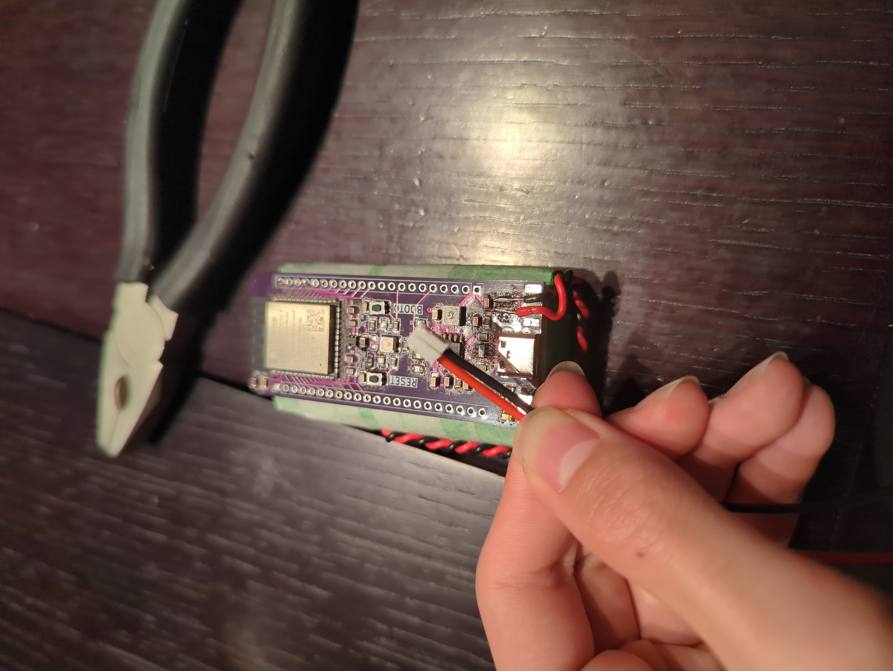
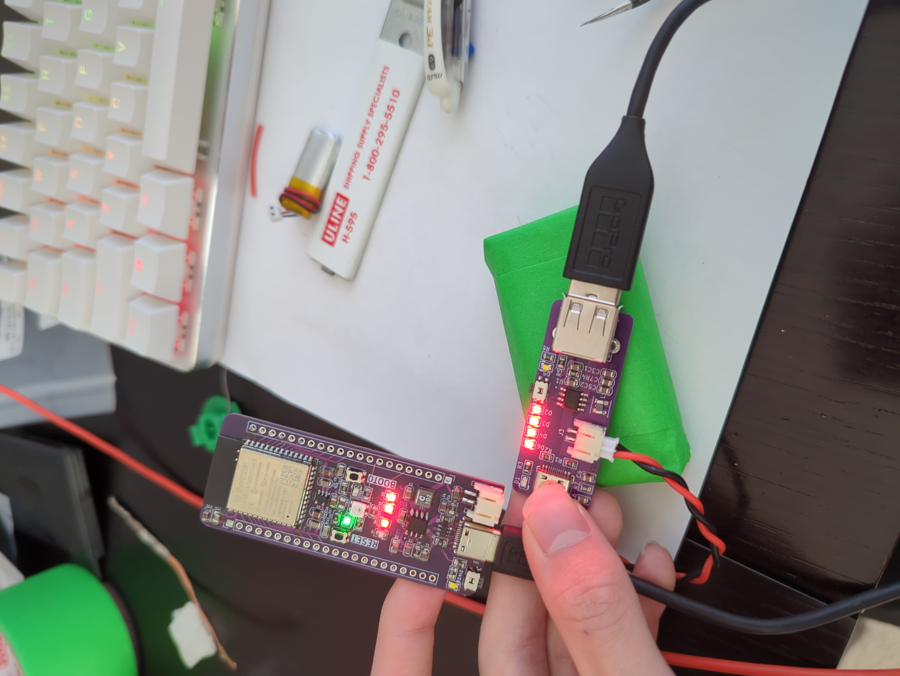
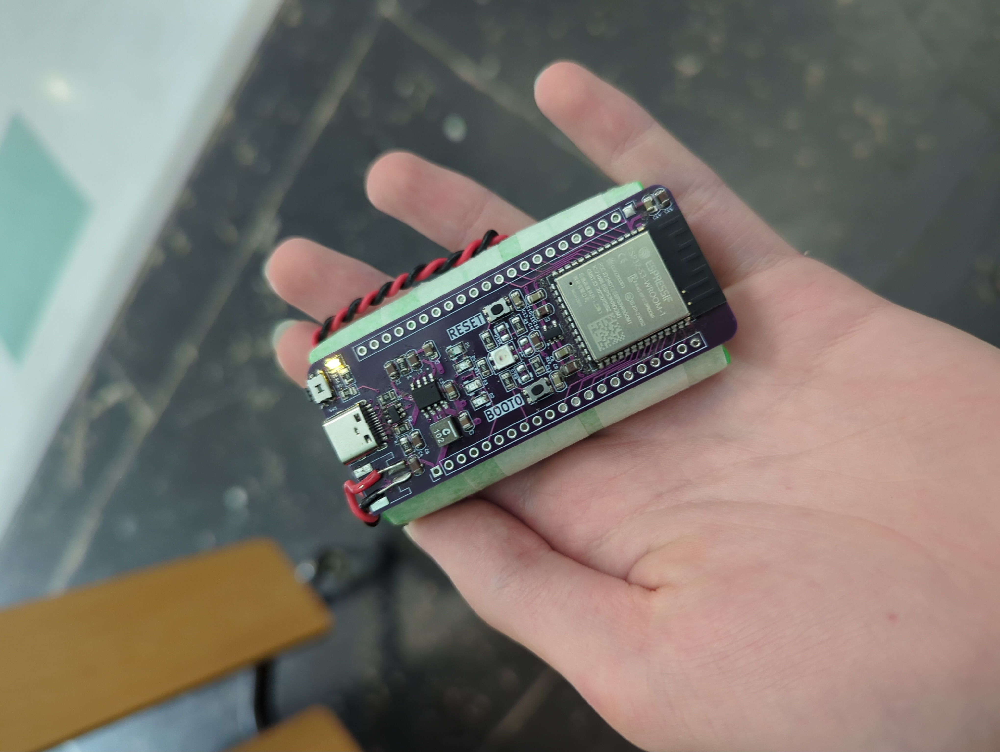

# ESP32-S3 Module

> A Feather-like ESP32-S3 dev board with USB-C, IP5306 battery charging, an onboard NeoPixel, and status LEDs.

This is a small, self-contained development board built around the ESP32-S3-WROOM-1U. The idea is a go-to prototyping board: drop in a LiPo, plug in USB-C, and you have a programmable ESP32-S3 with WiFi/BLE/Zigbee, a NeoPixel for quick visual feedback, and a full set of 2.54mm breakouts. I made it because my other ESP32 boards were either not ESP32-S3, had no USB, or needed an external FTDI adapter just to flash.

**Build status:** assembled and working. USB, charging, the NeoPixel, and the user LED have all been verified on the physical board. See [proof/V1](proof/V1/PROOF.md) for build photos and test results.





## Custom Features

- ESP32-S3-WROOM-1U (N8, 8 MB flash) with WiFi/BLE/Zigbee and a U.FL connector for an external antenna
- IP5306 power path: USB-C charging plus a 5V boost from a single-cell LiPo, with an LED battery gauge
- TLV75733 3.3V LDO for the MCU and logic
- USB-C receptacle with USBLC6-2SC6 ESD protection and 5.1k CC resistors
- Onboard WS2812B NeoPixel and 7 orange status LEDs
- RESET and BOOT buttons, plus an IP5306 power key
- Flashing over the ESP32-S3 native USB or over UART/FTDI through the headers
- 2.54mm header breakouts and a JST-PH battery connector

## How It Works

The board is four functional blocks plus a breakout. USB-C feeds the IP5306, which charges the LiPo and boosts it to a 5V rail. That rail powers the NeoPixel and feeds a TLV75733 LDO, which makes the 3.3V rail for the ESP32-S3. The MCU drives the NeoPixel on GPIO47 and the user LED on GPIO48, and breaks out its remaining IO on the two headers.

| Block | Key parts | What it does |
|-------|-----------|--------------|
| USB input | J1, U1, R1, R2 | USB-C receptacle, ESD protection, and 5.1k CC resistors |
| Charging / boost | U2 (IP5306), L1, R7, C4, C6 | Charges the LiPo and boosts it to +5V, with a LED gauge |
| 3.3V supply | U3 (TLV75733), C3, C5, C7, C10 | LDO that turns +5V into +3.3V for the MCU and logic |
| MCU | U4 (ESP32-S3-WROOM-1U) | WiFi/BLE/Zigbee, native USB, U.FL antenna |
| Indicators | D1-D8, R6, R10, R11 | Power, charge gauge, power key, user LED, NeoPixel |
| Controls | SW1, SW2, SW3 | IP5306 power key, BOOT0, RESET |
| Breakout | J3, J4, J2 | 1x22 and 1x21 headers and a battery connector |

### Power Tree



## PCB Design

The board is a 4-layer PCB measuring 35.70 x 79.00 mm, with 1.6mm thickness and a dedicated ground inner layer. Power traces are widened and the edges are rounded for handling. Routing is done by hand in KiCad.



Schematic and PCB sources live in [kicad/](kicad/). Fabrication outputs (Gerbers, drill, BOM, pick-and-place) are in [kicad/production/](kicad/production/), and the STEP model is in [cad/](cad/).

## Build

The board was assembled by hand: parts laid out and checked, the USB-C and power sections soldered first, then the headers and the JST-PH battery connector. After that came the power-on checks over USB-C and a power bank.

| | |
|---|---|
|  |  |
|  |  |



The NeoPixel and status LEDs running the self-test: [video/neopixel.mp4](proof/V1/video/neopixel.mp4).

More build and test detail: [proof/V1/PROOF.md](proof/V1/PROOF.md).

## Firmware

The firmware in [firmware/](firmware/) is an interactive self-test over USB CDC. It reports system info and power status, drives the NeoPixel and user LED, reads the BOOT button, runs a GPIO loopback check, and scans for WiFi and BLE networks. It is a PlatformIO project using the Arduino framework, the Adafruit NeoPixel library, and NimBLE-Arduino.

```bash
cd firmware
pio run                 # build
pio run --target upload # flash over USB
```

To enter the bootloader manually:
1. Hold BOOT (SW2 / IO0)
2. Tap RESET (SW3 / EN)
3. Release BOOT
4. Start the upload

See [firmware/README.md](firmware/README.md) for the pin map and library details.

## Usage

### Power

- Charging: plug a USB-C cable into J1. The IP5306 charges the LiPo through J2 and lights the charge gauge.
- Battery: connect a single-cell LiPo to the JST-PH connector (J2).
- The IP5306 power key (SW1) turns the 5V/3.3V rails on and off.

### Programming

- Native USB: connect USB-C and flash the ESP32-S3 directly (GPIO19/GPIO20).
- UART/FTDI: use TXD0 (J4 pin 18) and RXD0 (J4 pin 17) with GND, then trigger BOOT/RESET.

### Pinout

J3 - 1x22 header:

| Pin | Net | Pin | Net |
|-----|-----|-----|-----|
| 1 | GND | 12 | IO8 |
| 2 | +3.3V | 13 | USB_D- |
| 3 | EN | 14 | USB_D+ |
| 4 | IO4 | 15 | IO3 |
| 5 | IO5 | 16 | IO46 |
| 6 | IO6 | 17 | IO9 |
| 7 | IO7 | 18 | IO10 |
| 8 | IO15 | 19 | IO11 |
| 9 | IO16 | 20 | IO12 |
| 10 | IO17 | 21 | +5V |
| 11 | IO18 | 22 | VBUS |

J4 - 1x21 header:

| Pin | Net | Pin | Net |
|-----|-----|-----|-----|
| 1 | +BATT | 12 | IO38 |
| 2 | IO13 | 13 | IO39 |
| 3 | IO14 | 14 | IO40 |
| 4 | IO21 | 15 | IO41 |
| 5 | IO47 (NeoPixel) | 16 | IO42 |
| 6 | IO48 (User LED) | 17 | RXD0 |
| 7 | IO45 | 18 | TXD0 |
| 8 | IO0 (BOOT) | 19 | IO2 |
| 9 | IO35 | 20 | IO1 |
| 10 | IO36 | 21 | GND |
| 11 | IO37 | | |

Note: IO0, IO3, IO45, IO46 are ESP32-S3 strapping pins. Pull them the wrong way at boot and the chip enters a different mode.

## BOM

| Ref | Value | Qty | Unit $ | Ext $ |
|-----|-------|-----|--------|-------|
| C1, C2, C4, C6, C9, C11, C15, C17 | 10uF 25V X5R 0805 | 8 | 0.0871 | 0.6968 |
| C8, C10, C12, C13, C14, C16 | 100nF 50V X7R 0805 | 6 | 0.0266 | 0.1596 |
| C3, C5, C7 | 22uF 25V X5R 0805 | 3 | 0.0698 | 0.2094 |
| D1-D7 | Orange LED 0805 | 7 | 0.0096 | 0.0672 |
| D8 | WS2812B NeoPixel | 1 | 0.0940 | 0.0940 |
| J1 | USB-C receptacle 16P | 1 | 0.1724 | 0.1724 |
| J2 | JST-PH 2P 2mm | 1 | 0.0356 | 0.0356 |
| J3 | Pin header 1x22 2.54mm | 1 | 0.1200 | 0.1200 |
| J4 | Pin header 1x21 2.54mm | 1 | 0.1000 | 0.1000 |
| L1 | 1uH shielded inductor | 1 | 2.5134 | 2.5134 |
| R1, R2 | 5.1k 1% 0805 | 2 | 0.0065 | 0.0130 |
| R3, R5, R6, R8, R9, R10 | 10k 1% 0805 | 6 | 0.0035 | 0.0210 |
| R11 | 330 1% 0805 | 1 | 0.0050 | 0.0050 |
| R4, R7 | 2R 1% 0805 | 2 | 0.0261 | 0.0522 |
| SW1 | Tactile switch EVQPUD | 1 | 0.2299 | 0.2299 |
| SW2, SW3 | Tactile switch KMR2 | 2 | 0.6515 | 1.3030 |
| U1 | USBLC6-2SC6 | 1 | 0.0896 | 0.0896 |
| U2 | IP5306 | 1 | 0.2989 | 0.2989 |
| U3 | TLV75733PDBV | 1 | 0.1819 | 0.1819 |
| U4 | ESP32-S3-WROOM-1U (N8) | 1 | 3.1300 | 3.1300 |
| PCB | Bare PCB (4-layer) | 1 | 1.5000 | 1.5000 |
| **Total** | | **49** | | **10.9929** |

Full BOM with LCSC part numbers, manufacturers, and supplier links: [BOM.csv](BOM.csv). KiCad-generated BOM and pick-and-place: [kicad/production/bom.csv](kicad/production/bom.csv), [kicad/production/positions.csv](kicad/production/positions.csv).

## Production

The board is designed for JLCPCB's standard 4-layer process:

- 4 layers, 1.6mm thick
- HASL lead-free finish
- Gerbers and drill files: [kicad/production/ESP32-S3_Module.zip](kicad/production/ESP32-S3_Module.zip)

## Repository Structure

```
.
|-- BOM.csv                 # Full bill of materials with supplier links
|-- README.md
|-- JOURNAL.md              # Build journal
|-- TIMELINE.md
|-- TODO.md                 # Ideas for v2
|-- cad/                    # STEP model
|-- firmware/               # PlatformIO firmware (Arduino)
|-- images/                 # Schematic, PCB, and render images
|-- kicad/                  # KiCad sources and production outputs
|-- proof/                  # Build and test proof
|-- LICENSE                 # CERN-OHL-P-2.0 (hardware)
`-- LICENSE-MIT             # MIT (firmware)
```

## Known Issues

- WiFi, Bluetooth, and Zigbee have not been exercised yet. The self-test includes WiFi and BLE scan menus, but the radio results have not been confirmed on this board.
- The module uses a U.FL connector instead of an onboard antenna, so an external 2.4 GHz antenna is required for radio range.
- The current layout has DRC issues that should be cleaned up in v2: 2 shorting-item errors and 6 clearance errors around the ESP32 module footprint, plus 3 library footprint mismatch warnings. These are flagged in the committed PCB and did not stop the board from working, but they are not intentional.
- USB-C CC lines are 5.1k sink resistors, so the board draws power but does not negotiate anything above the default USB current.

## Credits & Inspiration

- Form factor inspired by the Adafruit Feather line.
- The IP5306 power section was adapted from my own earlier IP5306-based projects.
- Built with [KiCad](https://www.kicad.org/) and [PlatformIO](https://platformio.org/).
- Firmware uses the [Adafruit NeoPixel](https://github.com/adafruit/Adafruit_NeoPixel) library.
- Espressif ESP32-S3 datasheets and the ESP32-S3 Hardware Design Guidelines.

## License

- Hardware (schematics, PCB, and CAD): CERN Open Hardware Licence Version 2 - Permissive. SPDX: `CERN-OHL-P-2.0`. See [LICENSE](LICENSE).
- Firmware (`firmware/`): MIT License. SPDX: `MIT`. See [LICENSE-MIT](LICENSE-MIT).
