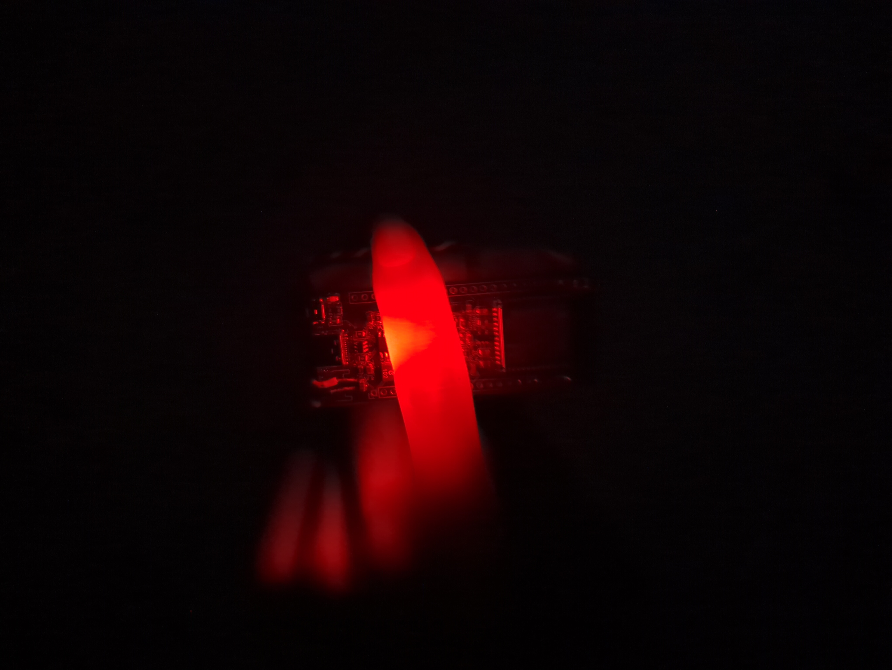
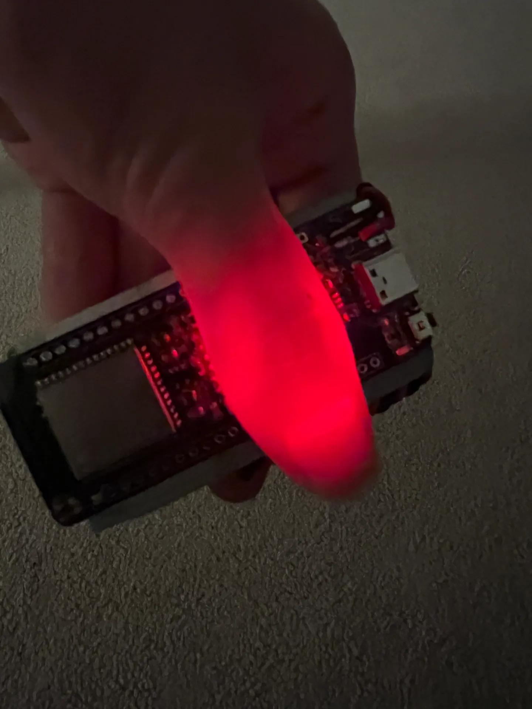
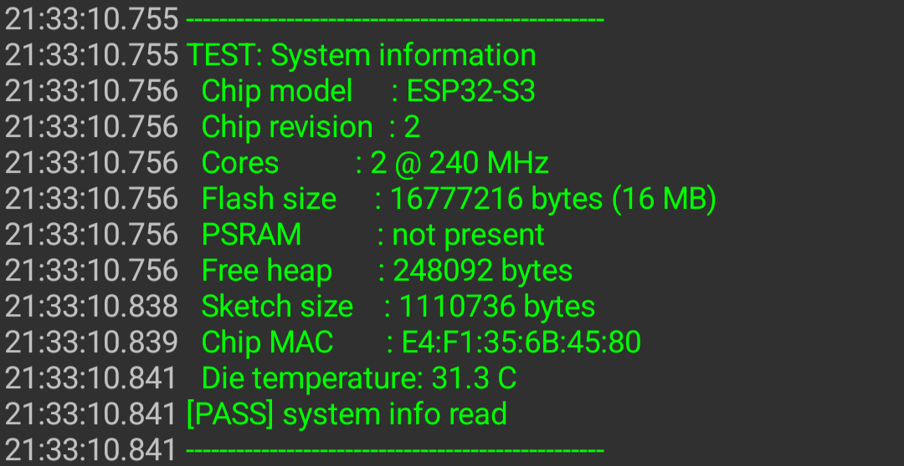

# ESP32-S3 Module - Build Proof (V1)

Date assembled: October 5-6, 2026
Board revision: V1
Firmware: `firmware/` (PlatformIO, Arduino self-test, Adafruit NeoPixel + NimBLE)

## Bottom line

The V1 board was assembled and works. It powers from USB-C, charges a single-cell LiPo through the IP5306, runs the NeoPixel rainbow from `firmware/`, and pulses the orange user LED. WiFi and Bluetooth were not tested on this revision.

## Build

Hand-assembled V1 using the JLCPCB 4-layer fabrication outputs in `kicad/production/` and the parts in `BOM.csv`. Some of the photos below are from the school lab (the "at school" and "torch mode" shots).

Parts arrived, then the through-hole connector work and the first power-up:

| Parts | JST-PH soldered | Connector crimped |
|-------|-----------------|-------------------|
|  |  |  |

Assembled and charging, and running off a power bank:

| Assembled, charging | Powered from a power bank |
|---------------------|---------------------------|
|  |  |

## Testing

| Test | Result | Notes |
|------|--------|-------|
| USB-C power | PASS | Board powers and boots from USB-C. |
| Battery charging | PASS | IP5306 charges the LiPo; the charge gauge LEDs light. |
| NeoPixel | PASS | D8 (WS2812B) shows the rainbow from `firmware/src/main.cpp`. |
| User LED | PASS | D7 pulses as a heartbeat on GPIO48. |
| WiFi / Bluetooth | NOT TESTED | Radio not exercised yet. |

## Media

NeoPixel running the rainbow (demo video):

Self-test serial output:

Demo video: [video/neopixel.mp4](video/neopixel.mp4)

## Files

- `firmware/src/main.cpp` - firmware self-test (system info, NeoPixel, user LED, BOOT, GPIO loopback, WiFi/BLE scan)
- `BOM.csv` - bill of materials
- `kicad/production/` - Gerbers, BOM, pick-and-place used for the build
